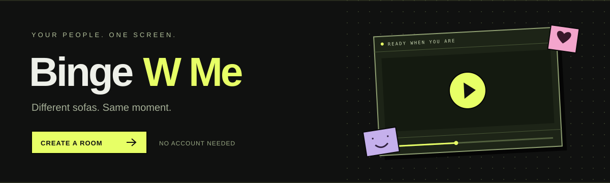

<p align="center">
  
</p>

<p align="center">
  <a href="https://github.com/havioo/bingewme/actions/workflows/ci.yml"></a>
  <a href="https://github.com/havioo/bingewme/commits/main"></a>
  <a href="https://github.com/havioo/bingewme"></a>
  <a href="https://github.com/havioo/bingewme/issues"></a>
</p>

# Different sofas. Same moment.

**Binge W Me** is a no-signup watch-party app for the group chat that actually wants to watch something. Create a room, send your people the link, and bring your own video. Playback, chat, reactions, and live annotations share one space.

Every room starts empty. Every new room gets a five-digit code, like **48271**, and a matching `/party/48271` link. Friends can type the code or paste the link on the homepage.

Codes are reserved by the room server so active rooms cannot collide. Copy the code directly from the room header or the invite panel. Unclaimed codes expire after five minutes; rooms close when their last guest leaves. Existing longer invite links remain supported.

[Get started](#run-locally) · [Features](#inside-the-room) · [Deploy](#deploy) · [Current boundaries](#current-boundaries)

## Inside the room

| Feature                           | What it does                                                                                                                                            |
| --------------------------------- | ------------------------------------------------------------------------------------------------------------------------------------------------------- |
| **Create & join**                 | Generate a unique room link or join with an existing link/code. Set an optional display name and leave a room from its header.                          |
| **Watch in sync**                 | Share YouTube and native-video play/pause, seeking, and playback speed. Correct timestamp drift above 1.5 seconds or request an immediate resync.       |
| **Bring your own media**          | Load direct video/audio URLs, HLS streams, a local file, or a screen share. YouTube uses room playback controls; Vimeo uses its own controls.           |
| **Your people, live**             | Room-scoped chat, floating emoji reactions, and a GIF picker. Add a server-side Giphy key for live GIF search.                                          |
| **Draw on the moment**            | Annotate the screen with normalized canvas strokes broadcast to the room. Pick a brush color, clear your canvas, and let marks fade after four seconds. |
| **Keep the remote under control** | Enable host-only playback controls or vote before pausing. Pause ballots last five seconds and require a majority.                                      |
| **Keep watching**                 | Share a room-wide media queue, choose the next video, adjust volume and speed, or use fullscreen and picture-in-picture where supported.                |
| **Make it yours**                 | Choose an accent and generate coordinated surfaces, borders, and text. Button foregrounds adapt for contrast; your palette persists in the browser.     |

### YouTube that follows the room

YouTube uses the IFrame Player API for shared play/pause, seeking, playback speed, timestamp correction, and late-join synchronization. The room toolbar and YouTube's own controls both publish playback changes. Watch links, short links, Shorts, live links, and embedded links are recognized.

If the browser blocks audible autoplay, the player tries muted playback to stay in sync and displays **Enable sound**. Some browsers can still require one tap to start playback on a device; the app exposes that action without changing the whole room's playback state. Embedding-disabled or unavailable videos show an error in the player. See [YouTube's API and autoplay events](https://developers.google.com/youtube/iframe_api_reference).

### A palette that follows your color

Pink should feel pink all the way through. The theme engine derives a low-saturation palette from your chosen hue and adjusts foreground colors for readability. Its tests check text contrast against every generated surface, including near-black and near-white accents. Reduced-motion preferences are respected, and interface animations use transforms and opacity.

### Media support at a glance

| Source                                     | Playback                                                | Room synchronization                                                       |
| ------------------------------------------ | ------------------------------------------------------- | -------------------------------------------------------------------------- |
| Direct MP4, WebM & browser-supported audio | Native player                                           | Shared playback controls and drift correction                              |
| HLS / `.m3u8`                              | Native HLS when available; lazy-loaded HLS.js otherwise | Native-player synchronization                                              |
| Local file                                 | Temporary upload with HTTP range streaming              | One upload; guests stream the same file with shared playback controls      |
| Screen share                               | Browser capture over WebRTC                             | One live broadcast; system audio depends on the browser and capture source |
| YouTube                                    | YouTube IFrame Player API                               | Shared playback, seek, speed, drift correction, and late joins             |
| Vimeo                                      | Embedded platform player                                | Platform controls only; playback is currently independent                  |

Local files are uploaded once to temporary storage on the room server. Guests receive the same playable URL and can stream or seek without selecting their own copy. Files are removed when the last guest leaves and become unavailable after a server restart. The application limit defaults to 1 GiB per file, configurable with `MAX_UPLOAD_BYTES`; your hosting provider can impose a lower request-size or disk limit. A file extension alone does not guarantee browser codec support.

Invite links open a name-entry screen before joining. Guests can reuse a saved name, choose a new one, or join as Guest. Joining with a code uses the name entered on the homepage, and names can be changed inside Room Settings without disconnecting.

## Run locally

Requires **Node.js 24+** and npm. The repository includes `.nvmrc` for version managers.

```sh
git clone https://github.com/havioo/bingewme.git
cd bingewme
npm ci
npm run dev
```

Open **http://localhost:5173**, choose **Create new room**, then copy the invite link for your guests. To join another room, paste its link or code on the home screen. Open the same invite in another browser to try synchronized playback.

The dev command starts Vite on port `5173` and the room server on `3001`. Vite proxies `/socket.io` and `/api` to the server. Other devices can use the network URL printed by Vite; screen capture, microphone, and camera require HTTPS outside localhost.

## Deploy

Binge W Me ships as **one Node service**: Express serves the built frontend and Socket.io handles the live room connection on the same port.

### Vercel frontend + room server

The included `vercel.json` configures the Vite build and rewrites `/party/<code>` to the React app, so creating, joining, and refreshing room links work on Vercel. API and asset paths are not rewritten to HTML.

**Deploying the Vite frontend does not start `server/index.js`.** With the current in-memory room implementation, use one running Node service for room coordination. Vercel's WebSocket support alone does not share in-memory rooms across function instances; an all-Vercel backend would also need distributed room state and pub/sub coordination.

To keep the frontend on Vercel:

1. Deploy this repository as a Node web service. The included Render Blueprint preconfigures its build command and health check:

   [](https://render.com/deploy?repo=https://github.com/havioo/bingewme)

2. On that service, set `FRONTEND_ORIGINS` to your exact frontend origin, such as `https://binge.axryn.xyz`. Separate multiple origins with commas. The Blueprint already allows that domain.
3. In Vercel → Project → Settings → Environment Variables, add `VITE_ROOM_SERVER_URL` with the Node service's HTTPS URL. Use the service origin without an API path.
4. Redeploy Vercel. The public backend URL is included at build time; changing it requires a fresh build.

Visit the Node service's `/api/health` endpoint to check that it returns `{"status":"ok"}`. The free Blueprint is intended for trying the app; idle spin-downs or service restarts can end temporary rooms. Alternatively, host the entire app on the Node service and point your domain there; then no separate frontend/backend URL setting is needed.

See [Vercel's Vite routing documentation](https://vercel.com/docs/frameworks/frontend/vite) and [WebSocket state guidance](https://vercel.com/docs/functions/websockets) for the deployment behavior behind this setup.

### Single Node service

Set the runtime to Node.js 24 or later, then use:

| Setting        | Value                                           |
| -------------- | ----------------------------------------------- |
| Build command  | `npm ci && npm run build`                       |
| Start command  | `npm start`                                     |
| Port           | `PORT` from the environment; defaults to `3001` |
| Instance count | One instance while room state lives in memory   |
| Transport      | HTTPS with WebSocket upgrades enabled           |

```sh
npm ci
npm run build
npm start
```

The app is available at **http://localhost:3001**. The same server handles direct visits to `/party/<code>`. Deploy the Node service rather than only uploading `dist` to static hosting. Keep `server/`, `dist/`, package files, and installed production dependencies together.

### Docker

The multi-stage image builds the frontend, removes development dependencies, and runs the app as a non-root user.

```sh
docker build -t bingewme .
docker run --rm --init -p 3001:3001 --env-file .env bingewme
```

Create `.env` from `.env.example` first, or omit `--env-file .env` to use the defaults. Place the container behind your HTTPS reverse proxy and forward WebSocket upgrades to the same service.

### Environment

The Node service needs writable temporary disk space for uploaded media. Set `MAX_UPLOAD_BYTES` to adjust the application's per-file limit (default `1073741824` bytes / 1 GiB). Provider request-size, disk, bandwidth, and proxy timeout limits still apply. Uploads use the Node service directly when `VITE_ROOM_SERVER_URL` is set, so video bytes do not pass through the Vercel frontend.

For split hosting, set `VITE_ROOM_SERVER_URL` on the frontend before building and `FRONTEND_ORIGINS` on the Node server. Both are public URL settings. Leave them empty when hosting the whole app on one Node service.

| Variable        | Required | Purpose                                                                                              |
| --------------- | -------- | ---------------------------------------------------------------------------------------------------- |
| `PORT`          | No       | HTTP and Socket.io listening port. Default: `3001`.                                                  |
| `GIPHY_API_KEY` | No       | Enables live Giphy search on the server. Without it, the picker searches a small curated collection. |

Pass variables through your hosting provider or container environment. For a local server with an `.env` file, use `node --env-file=.env server/index.js` after building. Keep the Giphy key on the server; it is never a frontend build variable. `.env` files are ignored by Git.

## Under the hood

```text
src/
  components/
    RoomLobby.tsx          Create and join rooms
    RoomEntry.tsx          Choose a name before opening an invite
    player/                Media engine and playback controls
    canvas/                Live canvas annotations
    chat/                  Reactions and GIF picker
  hooks/useWebRTCSync.ts    Socket events and WebRTC signaling
  lib/                     Room codes, theme generation, file staging
  styles/                  Brutalist layout and adaptive theme tokens
  store.ts                 Typed Zustand application state
server/index.js            HTTP routes, rooms, votes and signaling
server/room-media.js       Room-scoped temporary uploads and range streaming
tests/                     Rendering, room isolation and palette checks
```

**Frontend:** React 19, TypeScript, Vite, Tailwind CSS, Lucide and Zustand. **Live layer:** Socket.io and native WebRTC. **Media:** HTML video, HLS.js and IndexedDB. The HLS engine is downloaded only when an HLS source needs it.

## Checks that travel with the code

```sh
npm run format:check
npm run build
npm test
```

GitHub Actions runs these checks on pushes to `main` and on pull requests. The badges above reflect the repository's current workflow status, commit history, language mix, and open issues.

Tests cover room-link parsing, unique room codes, invite name entry, lobby and empty-player rendering, shared queue updates, late joiners, authenticated file uploads, HTTP range streaming, room-file cleanup, username changes, room isolation, chat delivery, host locking, delayed playback readiness, majority voting, adaptive-palette contrast, and saved theme preferences. Use `npm run format` to apply the shared formatting rules.

## Current boundaries

The core watch-room experience is implemented. These limits matter when choosing how to deploy and use it:

- **Temporary rooms:** memberships, shared queues, playback snapshots, and uploaded files live in one server process. Rooms disappear when the last guest leaves or the process restarts. Theme choices are browser-local.
- **Link-based access:** a room link is an invitation, not authenticated access. Passcodes, persistent rooms, durable bans, and a full moderation dashboard are not implemented.
- **WebRTC reachability:** screen sharing uses direct peer connections with a public STUN server. There is no TURN relay, SFU, adaptive bitrate controller, or tested large-room video capacity. The 100-member cap is a membership limit.
- **Camera & voice:** camera preview is local. Shared webcam feeds, spatial voice, per-peer volume control, and active voice meters are not implemented.
- **Media adapters:** Twitch, arbitrary-page scraping, Vimeo synchronization, hover thumbnails, and audio gain boosting are not implemented. Browser policies and source-server permissions can restrict playback.
- **Extended customization:** queue reordering/removal, skip votes, custom room backgrounds, custom badges/emote packs, and GIF overlays are not implemented.

Before operating a public service, provision network relays as needed and add deployment-appropriate rate limits, session authentication, and durable moderation. Automated tests do not establish browser compatibility or production load capacity.

---

<p align="center"><strong>Less scrolling. More together.</strong><br/><sub>Bring the movie. Bring your people.</sub></p>
